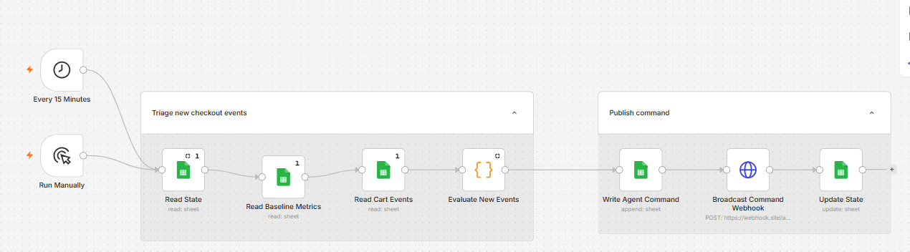

# Checkout Incident Detection & Automated Triage (n8n)

A **rule-based**, event-driven workflow for monitoring synthetic checkout failure events, classifying incident severity, logging commands, and notifying a downstream webhook.

> **Portfolio template:** This workflow is not yet a live public demo and does not use an LLM or autonomous AI agent. The sanitized export has not been independently executed.

## Business problem
Checkout failures can affect revenue and customer experience. This workflow processes new checkout failure events and creates traceable HIGH/ALERT or LOW/LOG commands.

## Workflow
1. **Every 15 Minutes** or **Run Manually** starts processing.
2. **Read State** retrieves `last_processed_timestamp`.
3. **Read Baseline Metrics** loads reference values per checkout step.
4. **Read Cart Events** fetches event records.
5. **Evaluate New Events** filters new events, evaluates JavaScript rules, and creates one command per batch.
6. **Write Agent Command** appends a record to `agent_commands`.
7. **Broadcast Command Webhook** POSTs the command.
8. **Update State** advances the checkpoint after the webhook completes.

## Decision rules
A batch is HIGH / ALERT if it includes **any PAYMENT event**, **any cart value >= 500**, **a checkout-step share of new failure events above its baseline**, or **at least two MOBILE events**. Otherwise it is LOW / LOG. No new events means no command.

**Measurement caveat:** The code calculates `step event count / total new failure events`. This is the *share of failure events by step*, **not a true checkout failure rate**. Baselines must use the same definition to be comparable.

## Import and run
1. Import [`workflows/checkout-incident-agent.template.json`](workflows/checkout-incident-agent.template.json) into n8n.
2. Create a Google Sheet with tabs `state`, `baseline_metrics`, `cart_events`, `agent_commands`. Headers are in [`sample-data/`](sample-data/).
3. Replace `REPLACE_WITH_YOUR_GOOGLE_SHEET_ID` in each Google Sheets node with your own ID and connect your own Google Sheets OAuth credential.
4. Replace `https://example.invalid/replace-with-your-webhook` with an endpoint you control.
5. Confirm field mappings and run manually using synthetic events before enabling the 15-minute schedule.

Do not commit private spreadsheet URLs, credentials, customer records, or real webhook endpoints.

## Architecture and limitations
See [`docs/architecture.md`](docs/architecture.md) for system design, state handling, and operational risks.

## Skills demonstrated
n8n orchestration · Google Sheets · JavaScript transformation · scheduled automation · webhooks · stateful incremental processing · incident triage · audit logging.

## Next enhancements
Recruiter-facing n8n Form; actual failure rates using failed/total attempts; idempotent event handling; retries and monitoring; optional guarded LLM incident analysis.

## License
No license has been added yet.
