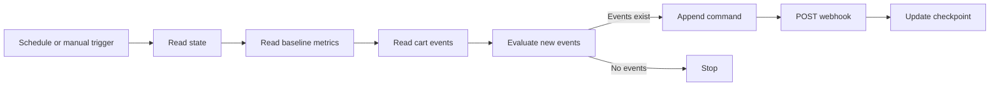

# Architecture and technical review

## Data schema
- `state`: `key`, `value` (last processed timestamp)
- `baseline_metrics`: `checkout_step`, `baseline_rate`
- `cart_events`: `timestamp`, `checkout_step`, `device`, `cart_value`
- `agent_commands`: `command_id`, `action`, `severity`, `reason`, `checkout_step`, `cart_value`, `device`, `baseline_rate`, `timestamp`

## What is implemented
- Fifteen-minute schedule and manual trigger.
- Timestamp-based incremental event selection.
- One command per nonempty batch, with a representative event.
- Thresholds `HIGH_CART_VALUE = 500`, `MOBILE_FAILURE_THRESHOLD = 2`.
- Google Sheets command append, HTTP POST, and checkpoint update.

## Known limitations
1. **Not agentic AI:** No LLM, AI Agent node, or autonomous tool-selection loop is present.
2. **Metric mismatch:** `stepCounts / total` represents the distribution of failure events, not failure rate against total checkout attempts. Compare only to compatible baselines.
3. **Partial failure duplicates:** A command is appended before the webhook and checkpoint update. Failed webhook calls may lead to duplicate commands on retry.
4. **No durable idempotency:** `command_id` is generated per execution rather than derived from a stable event/batch identifier.
5. **Timestamp boundary:** The strict `>` filter can miss late-arriving events sharing the checkpoint timestamp.
6. **Concurrent executions:** Multiple runs could read the same checkpoint.
7. **Input validation:** Invalid cart values become zero and unparseable timestamps are dropped.
8. **No public interface:** Only schedule and manual triggers are configured.
9. **No independent run validation:** Export and screenshot show design, not demonstrated production results.

## Recommended improvements
Add stable event IDs, deduplication, retries, safe failure recovery, actual denominator-based failure rates, a public synthetic-data form, and optional AI-assisted incident explanations.
